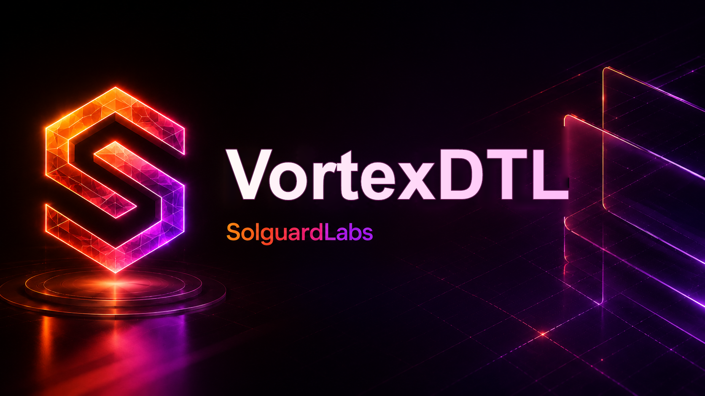

# Vortex DTL



Vortex DTL es un laboratorio CTF sobre un motor C de pricing y liquidacion para
swaps DTL internos entre bovedas con distintas precisiones, fees dinamicas y
rebates. La suite JavaScript valida quotes normales, slippage, fees, rounding y
settlement con un modelo determinista equivalente al binario.

La implementacion esta disenada como un sistema financiero compacto: no abre
puertos, no usa servicios externos y todas las rutas, precios, bovedas y
balances se cargan desde fixtures locales.

## Componentes

- `include/vortexdtl.h`: API publica del motor C.
- `src/vdtl_amount.c`: aritmetica entera, escalado decimal y redondeos.
- `src/vdtl_registry.c`: assets, rutas, legs y bovedas de referencia.
- `src/vdtl_quote.c`: quotes preliminares, reserva y liquidacion final.
- `src/vdtl_ledger.c`: estado contable y settlement de ordenes.
- `src/vdtl_controls.c`: minOut, policy checks y health de vaults.
- `src/vdtl_json.c`: serializacion JSON estable para CLI.
- `src/main.c`: comandos reproducibles del laboratorio.
- `tests/helpers`: modelo JavaScript usado por los tests.
- `tests/node`: tests de integracion y reproduccion del CTF.

## Requisitos

- Node.js `>= 20`.
- Opcional: `cc`, `gcc`, `clang` o MSVC `cl` para compilar el motor C.

La maquina local puede ejecutar toda la suite JS sin compilador C. Si hay
compilador disponible, `npm run build` genera `build/vortexdtl`.

## Uso

Ejecutar los tests:

```bash
npm run test
```

Ejecutar el flujo completo local:

```bash
npm run ci
```

Compilar el binario C si hay compilador disponible:

```bash
npm run build
```

Forzar error si no hay compilador:

```bash
npm run build:required
```

Ejecutar escenarios mediante el modelo JS:

```bash
npm run demo
npm run exploit
npm run policy
npm run health
```

Si el binario C existe, acepta comandos equivalentes:

```bash
build/vortexdtl demo-json
build/vortexdtl quote-json stable-direct 2500000
build/vortexdtl route-policy-json stable-direct
build/vortexdtl health-json
build/vortexdtl exploit-json
```

## Modelo Del Protocolo

El motor representa una orden DTL como:

1. `quote`: cotizacion preliminar de una ruta.
2. `reserve`: reserva de fondos basada en la quote preliminar.
3. `settle`: liquidacion final y acreditacion de saldos.

Cada ruta contiene legs con:

- asset origen y destino;
- precision decimal de cada asset;
- ratio entero `rate_num/rate_den`;
- fee base;
- fee de volatilidad;
- fee dependiente de utilizacion;
- rebate de maker.

Las rutas normales usan activos como `vUSD`, `vEUR` y `vREB`. La ruta de CTF
`vortex-loop` pasa por activos artificiales con la misma paridad economica pero
distinta precision decimal:

```text
vUSD(6) -> vQ7(7) -> vQ3(3) -> vQ8(8) -> vQ2(2) -> vQ5(5) -> vUSD(6)
```

## Objetivo CTF

Encuentra una secuencia de swaps que extraiga liquidez de forma progresiva
aprovechando diferencias de redondeo entre quote preliminar, reserva y
liquidacion final.

Pistas de alto nivel:

- la quote preliminar normaliza hacia una precision comun y redondea hacia
  abajo;
- la reserva reconstruye el input necesario caminando la ruta en sentido
  inverso y vuelve a redondear hacia abajo;
- la liquidacion final ejecuta hacia adelante y usa redondeo hacia arriba en
  conversiones de precision;
- cada fase parece localmente valida, pero las tres no son equivalentes;
- el impacto aumenta al repetir rutas largas con saltos por assets de baja
  precision.

## Tests

La suite cubre:

- quotes normales y campos JSON deterministas;
- control de slippage;
- fee dinamica y rebate;
- minOut, validacion operativa de rutas y health de vaults;
- rounding entre assets con distinta precision;
- settlement contable;
- reproduccion de la ruta vulnerable.

El test de reproduccion no es una solucion completa de auditoria; solo muestra
que existe una operacion con reserva inferior al credito final.

## Estado

Este repositorio es un CTF autocontenido. No debe usarse como motor financiero
real. La vulnerabilidad intencional esta documentada en `vulnerability.md`, que
queda ignorado por `.gitignore` para evitar publicarlo por accidente.
