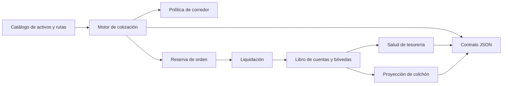
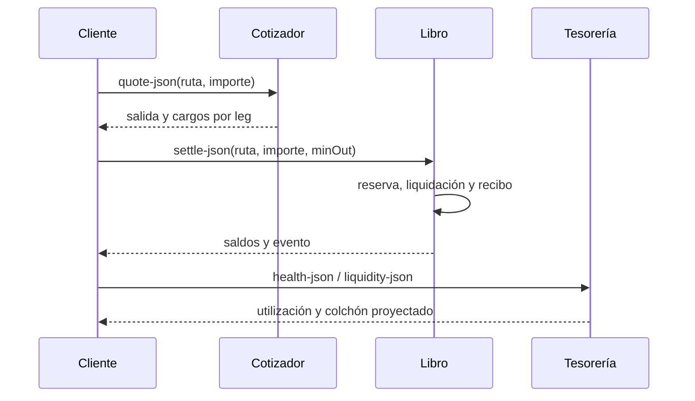

# VortexDTL


VortexDTL es un motor de cotización y liquidación de corredores DTL con núcleo C11 y cliente de referencia JavaScript. Administra rutas de varios activos con precisión decimal heterogénea, tarifas dinámicas, rebates de creador de mercado y reservas por bóveda. Produce salidas JSON estables para integrar paneles operativos y comprobaciones de tesorería.

## Arquitectura



El binario C y el cliente JavaScript comparten escenarios deterministas. `include/vortexdtl.h` define tipos, estados y funciones del motor. `src/vdtl_amount.c` concentra escala decimal, bps y redondeos; `src/vdtl_quote.c` calcula cotizaciones y conversiones; `src/vdtl_ledger.c` registra saldos y recibos. Los módulos `vdtl_controls.c` y `vdtl_json.c` exponen reportes de política, salud y capacidad de reserva.

## Modelo económico

Cada leg convierte un entero del activo origen a una precisión común de 12 decimales, aplica el ratio `rate_num/rate_den` y expresa el resultado en la precisión del destino. La tarifa dinámica del leg es `base + volatilidad + floor(utilización × cap / 10.000)` bps; los rebates se liquidan por activo. Una orden pasa por cotización, reserva y liquidación; `minOut` protege el umbral solicitado. Los importes son unidades mínimas de su respectivo activo, no números de coma flotante.



La proyección de liquidez toma la reserva disponible del activo y calcula un colchón configurado en bps sobre su liquidez de apertura. Devuelve disponibilidad proyectada, holgura y parte no financiada. Es una consulta de planificación: no mueve fondos ni sustituye la política de ejecución.

## Ejecución

Requiere Node.js 24 para la suite y un compilador C11 (`cc`, `gcc`, `clang` o MSVC) para el binario nativo. En Linux:

```bash
npm ci
npm run ci
./build/vortexdtl quote-json stable-direct 2500000
./build/vortexdtl liquidity-json vUSD 1000000 500
```

El cliente de referencia funciona sin compilar C:

```bash
node scripts/vortex-js.mjs demo-json
node scripts/vortex-js.mjs route-policy-json stable-direct
node scripts/vortex-js.mjs health-json
node scripts/vortex-js.mjs liquidity-json vUSD 1000000 500
```

Para el corredor `stable-direct`, una entrada de `2_500_000` unidades de vUSD produce una cotización preliminar de `2_311_805` unidades de vEUR con tarifa dinámica de 13 bps. Consulte [modelo económico](docs/modelo-economico.md) para el cálculo completo y [contrato JSON](docs/contrato-json.md) para interpretar salidas.

## Documentación

- [Arquitectura y ciclo de estados](docs/arquitectura.md)
- [Modelo económico y ejemplos](docs/modelo-economico.md)
- [Operación y validación](docs/operacion.md)
- [Contrato JSON](docs/contrato-json.md)
- [Política de seguridad](SECURITY.md)

La versión `1.0.0` identifica el código y contrato publicados. La rama `production`, el tag anotado `v1.0.0` y la release conservan la misma revisión; su publicación no conecta el motor con redes ni custodios externos.
