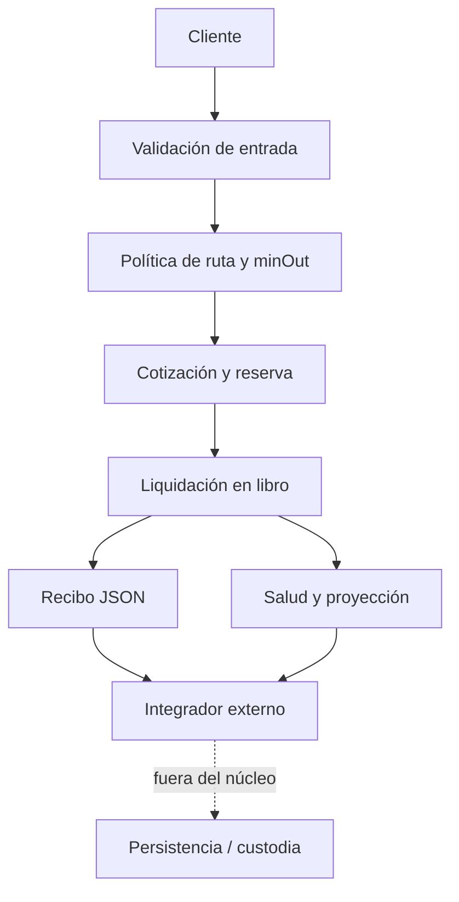

# Política de seguridad de VortexDTL

## Alcance

El núcleo C11, el cliente JavaScript, la CLI, las rutas registradas y sus salidas JSON forman la superficie verificable. Las identidades, el catálogo, los precios y los saldos de apertura se inicializan localmente. Persistencia, autenticación, transporte, custodia y ejecución en redes externas son responsabilidades de una integración posterior y no están implementadas aquí.



## Controles y propiedades a revisar

- La aritmética del motor usa enteros sin signo de 64 bits, estados de error explícitos y comprobaciones de rango/división para sus utilidades monetarias.
- `vdtl_check_route_policy` resume enlaces de ruta, ratios, tarifas, rebates y utilización; `warnings` es un bitmask documentado y `ok` indica ausencia de avisos de configuración.
- `vdtl_min_out_for_slippage` limita el descuento solicitado a 10.000 bps; una orden con umbral no satisfecho se rechaza.
- `vdtl_collect_ledger_health` agrega reservas disponibles, pagos, entradas y utilización observada por bóveda.
- `vdtl_project_vault_liquidity` calcula capacidad prospectiva por activo con colchón de apertura, sin mutar el libro. `withinPolicy` describe solo esa proyección, no una aprobación transaccional.
- CI exige compilación nativa C11, comprobación sintáctica JavaScript y suite de integración. La verificación de release exige identidad entre `main`, `production` y tag anotado.

## Comunicación de incidencias

No publique secuencias sensibles ni datos de terceros en incidencias abiertas. Un reporte privado debe incluir commit, ruta y configuración, importes en unidades mínimas, entradas ordenadas, estados antes/después, recibos JSON, impacto cuantificado y expectativa de reconciliación. Distinga un resultado del núcleo de cualquier comportamiento añadido por un integrador. Conserve pruebas y salida original antes de proponer cambios.

## Comprobación local

```bash
npm ci
npm run ci
./build/vortexdtl health-json
./build/vortexdtl liquidity-json vUSD 1000000 500
```

Para los límites exactos de los reportes, consulte [operación](docs/operacion.md) y [contrato JSON](docs/contrato-json.md).
