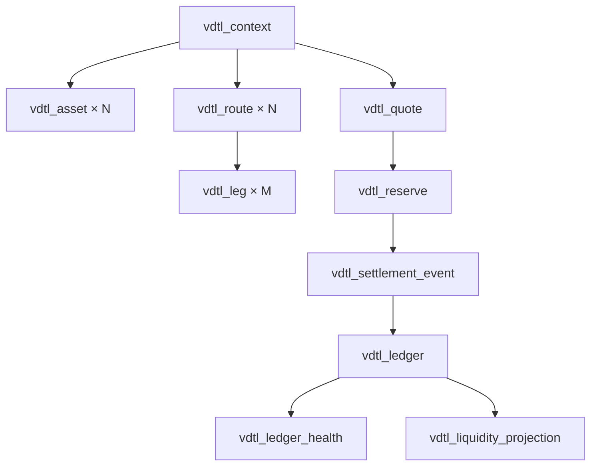

# Arquitectura y ciclo de estados

VortexDTL separa el catálogo de rutas de un libro mutable de cuentas y bóvedas. `vdtl_context` contiene activos, legs y ratios. `vdtl_ledger` mantiene balances de trader, maker y protocolo; cada bóveda distingue `available`, `reserved`, `paid` y `received`. El cliente JavaScript reproduce las operaciones para validar el contrato JSON y ofrecer una integración de referencia.

## Transición de orden

1. `vdtl_quote_route` produce la cotización preliminar y desglosa gross, tarifa, rebate y neto por leg.
2. El solicitante suministra `min_out`. El motor verifica que no supere la cotización aceptada.
3. `vdtl_reserve_for_quote` determina el importe de origen reservado para la salida cotizada.
4. `vdtl_settlement_forward` calcula la salida definitiva y `vdtl_settle_order` actualiza cuentas y bóvedas. El recibo conserva cotización, reserva, importe final y valores agregados.
5. `vdtl_collect_ledger_health` y `vdtl_project_vault_liquidity` permiten examinar el libro o simular un pago adicional sin modificarlo.

La CLI inicia un contexto reproducible para cada comando; las llamadas independientes no comparten estado. Una integración persistente debe aportar almacenamiento transaccional, serialización por bóveda e idempotencia de órdenes. El motor no firma mensajes ni consulta precios remotos.

## Componentes

| Archivo | Responsabilidad |
|---|---|
| `src/vdtl_registry.c` | Inicializa activos, rutas y saldos de apertura. |
| `src/vdtl_amount.c` | Escala decimal y aritmética monetaria. |
| `src/vdtl_quote.c` | Cotización, reserva, ratios y conversión por leg. |
| `src/vdtl_ledger.c` | Liquidación y movimientos de cuentas/bóvedas. |
| `src/vdtl_controls.c` | Política de ruta, salud y colchón prospectivo. |
| `src/vdtl_json.c` | Serialización JSON del contrato externo. |
| `tests/helpers/vortex-model.js` | Cliente determinista de referencia. |
