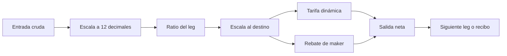

# Modelo económico

## Unidades y conversiones

Cada activo define `decimals` y `price_micro_usd`. Una cantidad cruda `A` representa `A / 10^decimals` unidades de ese activo. Para comparar valores, el motor expresa resultados en micro-USD. La precisión común del corredor es `12` decimales; los ratios de cada leg son fracciones enteras `rate_num/rate_den`. Las funciones de escala y redondeo son explícitas, sin representación binaria de coma flotante para los saldos.

La tarifa dinámica del leg es:

```text
fee_bps = base_fee_bps + volatility_fee_bps
        + floor(utilization_bps × utilization_fee_cap_bps / 10_000)
fee = floor(gross_out × fee_bps / 10_000)
net_out = gross_out - fee
```

El rebate se contabiliza por separado a favor del maker y no incrementa `net_out` del trader. Para `stable-direct` se configuran base 8 bps, volatilidad 2 bps, utilización 5.300 bps y cap 7 bps: el término variable es `floor(5.300×7/10.000)=3`, luego el total es 13 bps. Con `2_500_000` unidades de vUSD, la salida bruta de referencia es `2_314_814` unidades de vEUR; la tarifa es `3_009` y el rebate preliminar `462`. La cotización neta queda en `2_311_805` unidades mínimas de vEUR.



## Tesorería y colchón

La proyección nueva es por activo y parte de la liquidez disponible actual `A`. Para una salida hipotética `P` y un colchón `b` bps, calcula:

```text
required_buffer = ceil(opening_liquidity × b / 10_000)
unfunded = max(0, P - A)
projected_available = max(0, A - P)
headroom = max(0, projected_available - required_buffer)
within_policy = (unfunded == 0) AND (projected_available >= required_buffer)
```

Ejemplo con la bóveda vUSD de apertura `2_500_000_000_000` unidades: un colchón de 500 bps exige `125_000_000_000` unidades. Para un pago proyectado de `1_000_000`, quedan `2_499_999_000_000` disponibles y una holgura de `2_374_999_000_000`. La consulta no reserva ni paga ese importe. Tampoco evalúa otros activos o riesgos externos.

El reporte de salud utiliza `paid/(available+paid)` para utilización observada de una bóveda, acotada en bps. Los agregados de valor se leen junto al precio y los decimales del catálogo; no deben confundirse con unidades crudas de un activo.
